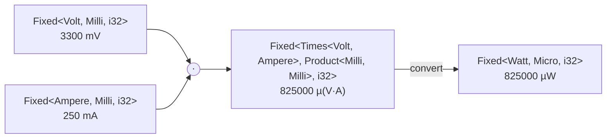

# Arithmetic

## Within one type

Two values of one type add and subtract. A plain number of the storage multiplies and divides:

```rust
use exact_units::{Fixed, prefix::Milli, units::Volt};

type MilliVolts = Fixed<Volt, Milli, i32>;

let a = MilliVolts::new(1200);
let b = MilliVolts::new(300);
assert_eq!(a + b, MilliVolts::new(1500));
assert_eq!(a - b, MilliVolts::new(900));
assert_eq!(a * 2, MilliVolts::new(2400));
assert_eq!(a / 4, MilliVolts::new(300));
```

`+` and `*` overflow as the storage's own operators do: a panic in a debug build, a wrap in a release build. When that matters, say what should happen:

| Method | On overflow | For |
|---|---|---|
| `checked_add`, `checked_mul`, ... | `None` | values from outside |
| `saturating_add`, ... | the nearest end | levels, set points |
| `wrapping_add`, ... | modulo $2^{\text{bits}}$ | free-running counters |

```rust
use exact_units::{Fixed, prefix::Milli, units::Volt};

let v: Fixed<Volt, Milli, i16> = Fixed::new(30_000);
assert_eq!(v.checked_add(Fixed::new(5_000)), None);
assert_eq!(v.saturating_add(Fixed::new(5_000)).get(), i16::MAX);
```

A type can carry its policy instead, so `+` itself saturates or wraps: [Overflow](overflow.md).

## Different scales don't mix

mV and V are different types. Adding them is a compile error, not a silent factor of 1000:

```rust,compile_fail
use exact_units::{Fixed, prefix::{Milli, One}, units::Volt};

let a: Fixed<Volt, Milli, i32> = Fixed::new(1200);
let b: Fixed<Volt, One, i32> = Fixed::new(1);
let _ = a + b;
```

Convert one side first, with [`to`](conversions.md).

## Products and quotients of two values

Two `Fixed` values multiply into a new unit and a new scale, both worked out by the compiler:



At run time that is one integer multiply. The scale of the product is exact: $10^{-3} \cdot 10^{-3} = 10^{-6}$.

```rust
use exact_units::{Fixed, prefix::{Micro, Milli}, units::{Ampere, Volt, Watt}};

let v: Fixed<Volt, Milli, i32> = Fixed::new(3300);
let i: Fixed<Ampere, Milli, i32> = Fixed::new(250);
let p = v * i;
assert_eq!(p.to_string(), "825000 µ(V·A)");
assert_eq!(p.convert::<Watt, Micro, i32>(), Some(Fixed::new(825_000)));
```

`convert` moves to a unit of the same dimension: V·A to W, V/Ω to A. A quotient works the same way, and the classic slip of a factor 1000 becomes a type error:

```rust,compile_fail
use exact_units::{Fixed, prefix::Milli, units::{Ampere, Ohm, Volt}};

let v: Fixed<Volt, Milli, i32> = Fixed::new(10);
let r: Fixed<Ohm, Milli, i32> = Fixed::new(1);
let _: Fixed<Ampere, Milli, i32> = v / r; // mV / mΩ is A, not mA
```

When the product doesn't fit the storage, or should land in another scale, the multiply is named: [Products and requantization](../fixed_point/products.md).

## Comparing

`==`, `<` and `sort` compare the stored numbers of one type. Values with different [bounds](bounds.md) but the same unit, scale and storage compare too: `PartialEq` and `PartialOrd` reach across bounds. `Eq`, `Ord` and `Hash` are stricter and stay within one exact type, bounds included, since a `HashMap` key or a sort needs a total, consistent order. A float storage has them too, where its bound refuses NaN: without NaN a float is a total order, −0 equal to +0 and hashed the same, so `Fixed<Volt, One, f32>` sorts, keys a `BTreeMap` and has `iter().max()`. A `MaybeNan` has no order at all.

```rust
use exact_units::{Fixed, prefix::One, units::Volt};

type V = Fixed<Volt, One, f32>;
let mut readings = [V::bounded(3.3), V::bounded(-0.0), V::bounded(1.8), V::bounded(0.0)];
readings.sort();
assert_eq!(readings.map(V::get), [-0.0, 0.0, 1.8, 3.3]);
assert_eq!(readings.iter().max(), Some(&V::bounded(3.3)));
```
