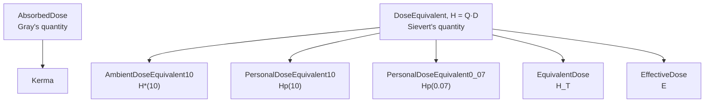

# Doses and weighting

The gray and the sievert are both J/kg, and each measures more than one quantity. The SI gives the gray to absorbed dose and to kerma (SI Brochure, 9th ed., Table 4). The sievert carries three quantities that are defined differently and used for different things:

- **Dose equivalent** H = Q·D at a point, with the quality factor Q a function of linear energy transfer (CIPM 2002, Recommendation 2). This is the SI's quantity. The operational quantities a monitor or a dosimeter reads, H*(10) and Hp(10), are dose equivalents at a stated depth.
- **Equivalent dose** H_T = Σ w_R·D_T,R, the mean absorbed dose in a tissue weighted by a radiation weighting factor w_R (ICRP Publication 103, Eq. 4.2).
- **Effective dose** E = Σ w_T·H_T, the tissue-weighted sum over the body of a Reference Person (ICRP Publication 103). Dose limits are written in it.

A number in Sv that doesn't say which of these it is reads three ways. So `exact_units` gives each its own quantity ([Quantities](quantities.md)), all of them kinds:



Every box is a kind: none converts or adds to another. The ones under `DoseEquivalent` are kinds under it so that a sievert can measure them, as `Of<EffectiveDose, Sievert>` (`units::EffectiveDose`). A bare `Sievert` is the SI's dose equivalent H.

```rust,compile_fail
use exact_units::{Fixed, prefix::Milli, units::{EffectiveDose, EquivalentDose}};

// an organ's equivalent dose is not an effective dose
let h = Fixed::<EquivalentDose, Milli, u32>::new(20);
let _ = h.convert::<EffectiveDose, Milli, u32>();
```

Each dose has a rate in the same shape: `AbsorbedDoseRate` (`GrayPerSecond`), `DoseEquivalentRate` (`SievertPerHour`) with `AmbientDoseEquivalentRate10` and the personal rates under it, `KermaRate`, `EquivalentDoseRate`, `EffectiveDoseRate`. A survey meter's µSv/h is `Fixed<Of<AmbientDoseEquivalentRate10, SievertPerHour>, Micro, u32>`. Gy/s does not convert to Sv/h.

## From a gray to a sievert: a weighting

Neither `convert` nor `as_quantity` takes a gray to a sievert. The step that does is a weighting, and the weight comes from a named, versioned set in `exact_units::radiation`, as a measured constant comes from a CODATA edition ([Constants](../nomicon/constants.md)):

```rust
use exact_units::{Fixed, prefix::Micro, radiation::{Icrp103, Icrp60}};
use exact_units::units::{EquivalentDose, Gray};

let d = Fixed::<Gray, Micro, u32>::new(2000);
let h: Fixed<EquivalentDose, Micro, u32> = d.equivalent_dose(Icrp103::PROTONS_AND_CHARGED_PIONS).unwrap();
assert_eq!(h.to_string(), "4000 µSv");
// the same protons by the 1991 recommendations
let h: Fixed<EquivalentDose, Micro, u32> = d.equivalent_dose(Icrp60::PROTONS_ABOVE_2_MEV).unwrap();
assert_eq!(h.to_string(), "10000 µSv");
```

The sets carry the tables as printed:

| Radiation | `Icrp103` (2007, Table 2) | `Icrp60` (1991, Table B.3 of ICRP 103) |
|---|---|---|
| Photons | `PHOTONS`, 1 | `PHOTONS`, 1 |
| Electrons, muons | `ELECTRONS_AND_MUONS`, 1 | `ELECTRONS_AND_MUONS`, 1 |
| Protons | `PROTONS_AND_CHARGED_PIONS`, 2 | `PROTONS_ABOVE_2_MEV`, 5 |
| Alpha, fission fragments, heavy ions | `ALPHA_FISSION_FRAGMENTS_HEAVY_IONS`, 20 | `ALPHA_FISSION_FRAGMENTS_HEAVY_NUCLEI`, 20 |
| Neutrons | `neutrons_f64(MeV)`, Eq. 4.3, a float | `neutrons(energy)`, bands, exact |

A weight a set doesn't give is a compile error: ICRP 60 has no `PROTONS_AND_CHARGED_PIONS`. The edition is named at the call, not carried in the type: an equivalent dose by ICRP 60 and one by ICRP 103 are the same quantity, as dose records add them in practice. Code that must keep editions apart declares a kind of its own under `EquivalentDose` with `quantity!`.

The step is exact or `None`. An integer weight that overflows the storage is `None`, and so is a fractional one whose product isn't a whole number of the storage's step; `equivalent_dose_rounded` names a [rounding](rounding.md) instead. ICRP 103's neutron weight is e^(−ln²(E)/6) and has no exact value, so it is a float edge: `Icrp103::neutrons_f64` (feature `libm`) gives a `WeightF64`, and `equivalent_dose_f64` multiplies into an `f64`.

A kerma takes no weighting until it is named an absorbed dose, the named step `as_quantity::<AbsorbedDose>()` that charged-particle equilibrium justifies:

```rust,compile_fail
use exact_units::{Fixed, prefix::Micro, radiation::Icrp103, units::{EquivalentDose, Kerma}};

let k = Fixed::<Kerma, Micro, u32>::new(2000);
let _: Option<Fixed<EquivalentDose, Micro, u32>> = k.equivalent_dose(Icrp103::PHOTONS);
```

## The dose equivalent: H = Q·D

The SI's dose equivalent weights by the quality factor Q(L) of the charged particles' linear energy transfer L in water, defined by ICRP 60 and kept by ICRP 103 (Eq. B.4.2): 1 below 10 keV/µm, 0.32·L − 2.2 up to 100 keV/µm, 300/√L above. `Icrp60::q_of_let` takes an L in `KiloElectronVoltPerMicrometer` (a `LinearEnergyTransfer`, not a force) and gives Q exactly where it is a fraction: always up to 100 keV/µm, above where √L is rational. Elsewhere it is `None`, and `q_of_let_f64` is the float edge.

```rust
use exact_units::{Fixed, prefix::{Micro, One}, radiation::Icrp60, quantities::AmbientDoseEquivalent10};
use exact_units::units::{Gray, KiloElectronVoltPerMicrometer, Of, Sievert};

let q = Icrp60::q_of_let(Fixed::<KiloElectronVoltPerMicrometer, One, u32>::new(50)).unwrap();
assert_eq!(q.ratio(), (69, 5)); // 13.8
let h: Fixed<Sievert, Micro, u32> = Fixed::<Gray, Micro, u32>::new(500).dose_equivalent(q).unwrap();
// what the calibration says this point is, named
let ambient: Fixed<Of<AmbientDoseEquivalent10, Sievert>, Micro, u32> = h.as_quantity();
assert_eq!(ambient.get(), 6900);
```

A Q from a measured spectrum is a `Weight` of the caller's, `Weight::new(num, den, of, source, year)`, with its source said.

## Effective dose: E = Σ w_T·H_T

The effective dose weights the equivalent doses of the organs and tissues of a Reference Person by the tissue weighting factors w_T of ICRP 103's Table 3 (the French edition's Tableau 4.2, again as Tableau B.2). `Icrp103::TISSUES` carries them, and `Icrp103Tissues` holds one value per tissue, so no tissue can be left out of the sum:

| Tissue | w_T |
|---|---|
| Red bone marrow, colon, lung, stomach, breast, remainder tissues | 0.12 each |
| Gonads | 0.08 |
| Bladder, oesophagus, liver, thyroid | 0.04 each |
| Bone surface, brain, salivary glands, skin | 0.01 each |

```rust
use exact_units::{Fixed, prefix::Micro, radiation::{Icrp103, Icrp103Tissues}};
use exact_units::units::{EffectiveDose, EquivalentDose};

let mut h = Icrp103Tissues::<Fixed<EquivalentDose, Micro, u32>>::default();
h.thyroid = Fixed::new(50_000); // 50 mSv to the thyroid
h.lung = Fixed::new(1000);
let e: Fixed<EffectiveDose, Micro, u32> = Icrp103::effective_dose(&h).unwrap();
assert_eq!(e.to_string(), "2120 µSv");
```

`effective_dose` takes the sex-averaged H_T. `effective_dose_by_sex(&male, &female)` is Eq. 4.5 itself, E = Σ w_T·(H_T^M + H_T^F)/2, with nothing rounded between the two. The remainder field is the arithmetic mean of the 13 remainder tissues of each sex (Eq. 4.6), as ICRP's dose coefficient tables give it; ICRP 60's splitting rule for the remainder is gone, so E is a plain sum.

The w_T are hundredths, so a sum is often no whole number of the storage's step. The step is exact or `None`, as the weightings are, and `effective_dose_rounded` rounds once, at the end. A float storage is exact or `None` too: 0.04 · 0.5 mSv is no `f64`. Equivalent dose rates give an effective dose rate the same way. An absorbed dose is refused: it takes its w_R first.

```rust,compile_fail
use exact_units::{Fixed, prefix::Micro, radiation::{Icrp103, Icrp103Tissues}, units::{EffectiveDose, Gray}};

let d = Icrp103Tissues::<Fixed<Gray, Micro, u32>>::default();
let _: Option<Fixed<EffectiveDose, Micro, u32>> = Icrp103::effective_dose(&d);
```

## A rate and its dose

A dose rate times a time is a plain product, `Derived`, and `as_quantity` could name it any quantity of that dimension. The named steps keep the pair: `rate.dose_over(t)` gives the dose of the rate's own kind, and `dose.rate_over(t)` the mean rate of the dose's kind. Ḣ*(10) over a time is an H*(10), never an Hp(10) or an effective dose. The pairs are each dose rate of the tree above with its dose: `AbsorbedDoseRate` and `AbsorbedDose`, `KermaRate` and `Kerma`, and so on for the dose equivalent, the three operational quantities, the equivalent dose and the effective dose.

```rust
use exact_units::{Fixed, prefix::{Micro, Nano, One}};
use exact_units::quantities::{AmbientDoseEquivalent10, AmbientDoseEquivalentRate10};
use exact_units::units::{Minute, Of, Sievert, SievertPerHour};

// a survey meter reads 3 µSv/h; 20 minutes there
let rate = Fixed::<Of<AmbientDoseEquivalentRate10, SievertPerHour>, Micro, u32>::new(3);
let t = Fixed::<Minute, One, u32>::new(20);
let h: Fixed<Of<AmbientDoseEquivalent10, Sievert>, Nano, u32> = rate.dose_over(t).unwrap();
assert_eq!(h.to_string(), "1000 nSv");
// and back
let back: Fixed<Of<AmbientDoseEquivalentRate10, SievertPerHour>, Micro, u32> = h.rate_over(t).unwrap();
assert_eq!(back, rate);
```

The result's unit, scale and storage are the caller's, usually given by the binding; the factor between the units (Sv/h times minutes into Sv) is worked out at compile time. The step is exact or `None` (a result that isn't a whole number of its step, a zero time, a value past the storage); `dose_over_rounded` and `rate_over_rounded` round once.

```rust,compile_fail
use exact_units::{Fixed, prefix::{Micro, One}};
use exact_units::quantities::{AmbientDoseEquivalentRate10, PersonalDoseEquivalent10};
use exact_units::units::{Of, Second, Sievert, SievertPerHour};

// an area monitor's rate gives no personal dose equivalent
let rate = Fixed::<Of<AmbientDoseEquivalentRate10, SievertPerHour>, Micro, u32>::new(3);
let _: Option<Fixed<Of<PersonalDoseEquivalent10, Sievert>, Micro, u32>> = rate.dose_over(Fixed::<Second, One, u32>::new(1));
```

## What the crate doesn't do

- **Rate arithmetic keeps no kind.** `rate * t` and `dose / t` are plain products; only `dose_over` and `rate_over` keep the pair. A quantity that declares its rate, so the operators keep it too, is an idea (UNIT-16).
- **The remainder's mean is the caller's.** Eq. 4.6's mean of 13 tissues per sex goes into the `remainder` field as a value; there is no step from the 13 tissues.
- **ICRU Report 95's operational quantities** (2020: H*, Hp from conversion coefficients to E, no depth) are not here, nor H′(0.07, Ω), H′(3, Ω) and Hp(3) of ICRU 51.
- **Older and national quantities** are the user's to declare: ICRP 26's effective dose equivalent, and the US NRC's TEDE, deep-dose and shallow-dose equivalents (10 CFR 20), which use ICRP 26/30 weights.
