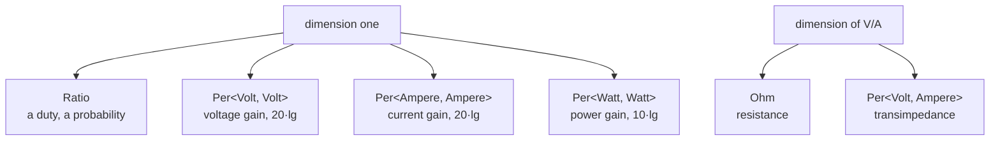

# Kinds of quantity

A voltage gain (V/V), a current gain (A/A), a power gain (W/W) and a duty cycle are all plain numbers: dimension one. A resistance (Ω) and a transimpedance (V/A) have one dimension too. Yet adding a gain to a duty cycle is a bug.

A unit's **kind** is part of its type, next to its dimension. `convert` refuses to cross kinds.



## The rules

- A unit is plain (only its dimension) unless its declaration names a kind (`Ohm` is a resistance).
- A quotient of one dimension keeps what cancelled: V/V is a ratio of voltages, not a plain `Ratio`.
- A dimension-one factor keeps the other side's kind: V/V · V is a plain V, and V/V · V/V is still a voltage gain.
- Any other product or quotient is plain: V/A is a transimpedance, not a resistance.

The rules follow ISO 80000-1's kinds of quantity, as the C++ library mp-units implements them.

## What doesn't convert

```rust,compile_fail
use exact_units::{Fixed, prefix::One, units::{Per, Ratio, Volt}};

let gain: Fixed<Per<Volt, Volt>, One, f32> = Fixed::<_, _, f32>::bounded(4.0);
let _ = gain.convert::<Ratio, One, f32>(); // a gain is not a duty cycle
```

```rust,compile_fail
use exact_units::{Fixed, prefix::Mega, units::{Ampere, Ohm, Per, Volt}};

let tia: Fixed<Per<Volt, Ampere>, Mega, f32> = Fixed::<_, _, f32>::bounded(1.0);
let _ = tia.convert::<Ohm, Mega, f32>(); // a transimpedance is not a resistor
```

A scale still converts within a kind: mV/V to V/V is fine.

## Crossing on purpose

Where crossing is right, it is a named step that keeps the number:

| From | Step | To |
|---|---|---|
| any dimension-one kind | `as_ratio()` | `Ratio` |
| `Ratio` | `as_gain::<Volt>()` | `Per<Volt, Volt>` |
| `Ohm` | `as_transimpedance()` | `Per<Volt, Ampere>` |
| `Per<Volt, Ampere>` | `as_resistance()` | `Ohm` |
| `Siemens` | `as_transconductance()` | `Per<Ampere, Volt>` |
| `Per<Joule, Volume>` | `as_energy_density()` | `EnergyDensity`, not a `Pascal` |
| `HeatCapacity`, `Per<Joule, Kelvin>` | `as_entropy()` | `Entropy` |
| `Entropy` | `as_heat_capacity()` | `HeatCapacity` |
| a cycle count per second | `to_hertz()` | `Hertz` |

```rust
use exact_units::{Fixed, prefix::{Mega, Micro, One}, units::{Ampere, Ohm, Per, Volt}};

// a transimpedance amplifier: its feedback resistor sets its V/A
let feedback = Fixed::<Ohm, Mega, f32>::bounded(1.0);
let tia: Fixed<Per<Volt, Ampere>, Mega, f32> = feedback.as_transimpedance();
// µA · MV/A is V
let photo = Fixed::<Ampere, Micro, f32>::bounded(0.3);
let out: Fixed<Volt, One, f32> = (tia * photo).convert().unwrap();
assert!((out.get() - 0.3).abs() < 1e-6);
```

## Why it matters for levels

A gain's level in dB depends on its kind: $20 \lg$ for V/V and A/A, $10 \lg$ for W/W. A plain `Ratio` has no level at all, so 0.5 duty can't become −3 dB by accident. See [Decibels](../levels/decibels.md).
