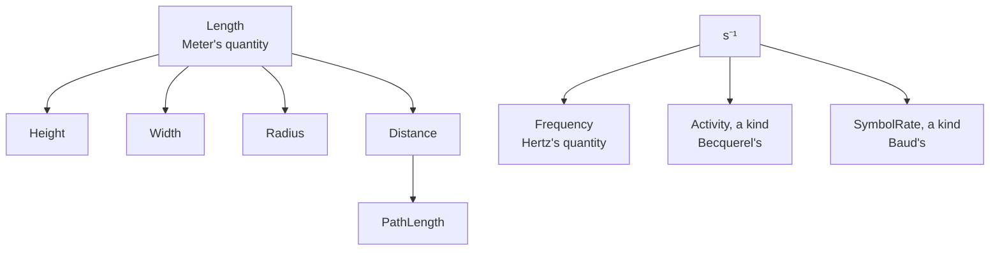

# Quantities

A height and a width are both lengths, in metres, and adding one to the other is still meaningful (a diagonal's
square). A resistance (Ω) and a transimpedance (V/A) share a dimension too, yet adding them is a bug. A frequency
(Hz) and a radioactive activity (Bq) share a dimension, s⁻¹, and have nothing else in common at all.

ISO 80000 calls this a **quantity**, and `exact_units` puts it in the type, next to the dimension:
`Fixed<Of<Height, Meter>, Milli, u16>` is a height, not a plain length, and `Ohm` is a resistance, not a bare V/A.
A unit whose declaration names no quantity of its own measures its dimension's *open root* instead (`Meter` is a
[Length], `Joule` an [Energy]), so most code never writes `Of` at all.



## The rules

- **Up is implicit.** `Fixed::up` relabels a value to an ancestor quantity with no `Option`: a height converts to a
  length, a length to its dimension's open root. `convert` takes the same rule, with an `Option` for a different
  scale too.
- **Down is a named step.** `Fixed::as_quantity::<Q>()` takes a value to a descendant (length to height, a derived
  `kg·m²/s²` to a kinetic energy) or back across a kind's edge (frequency to activity).
- **Siblings and other kinds are refused.** Width doesn't convert to height, nor a kinetic energy to a work, nor Ω
  to V/A: neither `convert` nor `up` crosses them, and the compiler says so wherever it can tell.
- **A sum is the nearest common ancestor.** Height plus width is a length.
- **A product or quotient is its dimension's open root**, named by a step, except that a quotient of one
  dimension is a ratio of it (V/V is a voltage gain, not a plain number) and a dimension-one factor keeps the
  other side's quantity (a gain times a resistance is still a resistance).

The rules follow ISO 80000-1's quantities and kinds as the C++ library mp-units implements them, without its
matching of recipes: a product is never recognised as a named quantity by itself, only by the step you name.

## Up the tree, with no step

```rust
# #[cfg(feature = "mechanical")] {
use exact_units::{Fixed, prefix::Milli, quantities::{Height, Width}, units::{Meter, Of}};

let h = Fixed::<Of<Height, Meter>, Milli, u16>::new(1200);
let w = Fixed::<Of<Width, Meter>, Milli, u16>::new(300);
let l: Fixed<Meter, Milli, u16> = h.up() + w.up(); // a height plus a width is a length
assert_eq!(l.get(), 1500);
# }
```

`up`'s target is usually inferred, which is why a sum across quantities reads `h.up() + w.up()`: Rust gives `+` no
way to make its own output type the two sides' common ancestor. A plain `convert` takes the same step, with an
`Option` for a different scale too:

```rust
# #[cfg(feature = "mechanical")] {
use exact_units::{Fixed, prefix::{Micro, Milli}, quantities::Height, units::{Meter, Of}};

let h = Fixed::<Of<Height, Meter>, Milli, u16>::new(1750);
assert_eq!(h.convert::<Meter, Micro, u32>(), Some(Fixed::new(1_750_000)));
# }
```

A length is not a height without the named step down, so this doesn't compile:

```rust,compile_fail
use exact_units::{Fixed, prefix::Milli, quantities::Height, units::{Meter, Of}};

let l = Fixed::<Meter, Milli, u16>::new(1200);
let _: Fixed<Of<Height, Meter>, Milli, u16> = l.up();
```

## Down the tree, a named step

A product has no quantity of its own until a step names one: `m·v²` is a plain `kg·m²/s²` until
`as_quantity::<KineticEnergy>()` says what it is.

```rust
# #[cfg(all(feature = "mechanical", feature = "std"))] {
use exact_units::{Fixed, prefix::One, quantities::KineticEnergy, units::{Gram, Joule, Of, Speed}};

let m = Fixed::<Gram, One, i32>::new(2000);
let v = Fixed::<Speed, One, i32>::new(3);
let e = (m * v * v).as_quantity::<KineticEnergy>();
let e: Fixed<Of<KineticEnergy, Joule>, One, i32> = e.convert().unwrap(); // g·m²/s² to J
assert_eq!(e.get(), 18);
# }
```

A kinetic energy is not a work, though both are energies, so a step down one tree never lands in another:

```rust,compile_fail
use exact_units::{Fixed, prefix::One, quantities::{KineticEnergy, Work}, units::{Joule, Of}};

let e = Fixed::<Of<KineticEnergy, Joule>, One, i32>::new(18);
let _ = e.as_quantity::<Work>();
```

## A kind's implicit step is refused, its named step is not

`Ohm` is a resistance, a kind of its own; `Per<Volt, Ampere>` is a plain V/A, a transimpedance. Both have the same
dimension, so an amplifier's transimpedance is easy to mistake for a resistor, which is exactly why `convert`
refuses the implicit step between them:

```rust,compile_fail
use exact_units::{Fixed, prefix::One, units::{Ampere, Ohm, Per, Volt}};
let _ = Fixed::<Per<Volt, Ampere>, One, f32>::bounded(50.0).convert::<Ohm, One, f32>();
```

```rust,compile_fail
use exact_units::{Fixed, prefix::One, units::{Ampere, Ohm, Per, Volt}};
let _ = Fixed::<Ohm, One, f32>::bounded(50.0).convert::<Per<Volt, Ampere>, One, f32>();
```

Where crossing is right, say so with the named step, which keeps the number:

```rust
use exact_units::{Fixed, prefix::{Mega, Micro, One}, units::{Ampere, Ohm, Per, Volt}};

// a transimpedance amplifier: its feedback resistor sets its V/A
let feedback = Fixed::<Ohm, Mega, f32>::bounded(1.0);
let tia: Fixed<Per<Volt, Ampere>, Mega, f32> = feedback.as_transimpedance();
// µA · MV/A is V
let photo = Fixed::<Ampere, Micro, f32>::bounded(0.3);
let out: Fixed<Volt, One, f32> = (tia * photo).convert().unwrap();
assert!((out.get() - 0.3).abs() < 1e-6);
```

A frequency and an activity are the sharpest case: both s⁻¹, with no ancestor relation at all, so the named step
crosses between them in either direction while the implicit one never does.

```rust
# #[cfg(feature = "time")] {
use exact_units::{Fixed, prefix::One, quantities::{Activity, Frequency}, units::{Becquerel, Hertz, Of}};

let f = Fixed::<Hertz, One, u32>::new(50);
let a: Fixed<Of<Activity, Hertz>, One, u32> = f.as_quantity::<Activity>();
let a: Fixed<Of<Activity, Becquerel>, One, u32> = a.convert().unwrap();
assert_eq!(a.get(), 50);
let back: Fixed<Hertz, One, u32> = a.as_quantity::<Frequency>().convert().unwrap();
assert_eq!(back, f);
# }
```

```rust,compile_fail
use exact_units::{Fixed, prefix::One, units::{Becquerel, Hertz}};
let _ = Fixed::<Hertz, One, u32>::new(50).convert::<Becquerel, One, u32>();
```

The same rule holds where a quantity is read from data at run time, not fixed in the type: a `UnitTable` walks its
parents to answer `converts`.

```rust
# #[cfg(feature = "time")] {
use exact_units::{QuantityExpr, Unit, units::{Becquerel, Hertz}};

assert_eq!(Hertz::QUANTITY.converts(Becquerel::QUANTITY, &()), Some(false));
# }
```

## Sums find the nearest common ancestor

`QuantityExpr::add` walks both sides up to where they meet; `quantities::Common<Q1, Q2>` names the result as a
marker, for generic code that can't just write `a.up() + b.up()`:

```rust
# #[cfg(feature = "mechanical")] {
use exact_units::{QuantitySpec, quantities::{Common, Height, Length, Width}};

assert_eq!(<Common<Height, Width>>::DEF.id, Length::DEF.id);
# }
```

Two kinds have no common ancestor at all, so naming one across trees is a compile error, not a silent `Derived`:

```rust,compile_fail
use exact_units::{QuantitySpec, quantities::{Common, Height, KineticEnergy}};
let _ = <Common<KineticEnergy, Height>>::DEF; // a kinetic energy and a height share no ancestor
```

## Products are derived, except what cancels or scales

A product or quotient is its dimension's open root (`Derived`) unless one side is dimension-one and itself a
ratio or a derived value, in which case it keeps the *other* side's quantity: a gain times a resistance is still
a resistance, not a bare derived Ω·(V/V).

```rust
use exact_units::{Fixed, prefix::{Milli, One}, units::{Ohm, Per, Volt}};

let gain = Fixed::<Per<Volt, Volt>, One, i32>::new(2); // ×2, dimension one
let r = Fixed::<Ohm, One, i32>::new(100);
let scaled: Fixed<Ohm, Milli, i32> = (gain * r).convert().unwrap(); // still a resistance
assert_eq!(scaled.get(), 200_000);
```

A quotient of one dimension is the special case `RatioOf` that dimension rather than a plain number: V/V is a
voltage gain, A/A a current gain, and the two don't mix even though both cancel to dimension one.

```rust,compile_fail
use exact_units::{Fixed, prefix::One, units::{Ampere, Per, Volt}};
let gain: Fixed<Per<Volt, Volt>, One, f32> = Fixed::bounded(4.0);
let _ = gain.convert::<Per<Ampere, Ampere>, One, f32>();
```

Nor is a voltage gain a plain duty cycle, though both are dimension one:

```rust,compile_fail
use exact_units::{Fixed, prefix::One, units::{Per, Ratio, Volt}};
let gain: Fixed<Per<Volt, Volt>, One, f32> = Fixed::bounded(4.0);
let _ = gain.convert::<Ratio, One, f32>();
```

## Open roots of the base units

Every SI base unit's dimension has its open root (`Length`, `Time`, `Mass`, `ElectricCurrent`,
`ThermodynamicTemperature`, `AmountOfSubstance`, `LuminousIntensity`), as do the common derived ones whose coherent
unit has a one-word symbol (`Force` for N, `SolidAngle` for sr, `LuminousFlux`, `Illuminance`, `Luminance`,
`CatalyticActivity`) and the bit's (`Information`). They change nothing a unit converts to: a line without a
quantity already measures its dimension's quantity. They give that quantity a name, `Derived` of kg being a mass.

## Some dimensions have no open root at all

A unit whose line names no quantity measures its dimension's open root — except where a dimension has none.
C/m² is the SI dimension of three quantities at once: the displacement field D, the polarization P and the
surface density of charge σ; A/m is the dimension of the magnetizing field H, the magnetization M and a linear
current density. None of the three is the dimension's "default" meaning, because [Gaussian units](systems.md)
count two of each trio 4π apart (D and P, H and M) even though SI's own numbers for them agree: picking one as
open would let the other cross silently wrong. So this crate declares `ElectricFluxDensity` (D),
`ElectricPolarization` (P, a kind under D) and `SurfaceChargeDensity`, and `MagnetizingField` (H),
`Magnetization` (M, a kind under H) and `LinearCurrentDensity`, every one a kind, and `Derived` of C/m² or A/m is
none of them.

The unit lines `ElectricDisplacement` and `MagneticFieldStrength` still name their quantity (`quantity
ElectricFluxDensity`, `quantity MagnetizingField`), so a value typed in one of them is already D or H. Building
the dimension from scratch, `Per<Ampere, Meter>`, gives the plain derived quantity instead, and reaching H from it
is the same named step as Ohm's:

```rust
# #[cfg(all(feature = "electrical", feature = "fields"))] {
use exact_units::{Fixed, prefix::One, quantities::MagnetizingField, units::{Ampere, Meter, Of, Per}};

let raw = Fixed::<Per<Ampere, Meter>, One, i32>::new(500); // a plain A/m: not H until named
let h: Fixed<Of<MagnetizingField, Per<Ampere, Meter>>, One, i32> = raw.as_quantity::<MagnetizingField>();
assert_eq!(h.get(), 500);
# }
```

```rust,compile_fail
use exact_units::{Fixed, prefix::One, units::{Ampere, MagneticFieldStrength, Meter, Per}};
let _ = Fixed::<Per<Ampere, Meter>, One, f32>::bounded(500.0).convert::<MagneticFieldStrength, One, f32>();
```

## Named steps this crate ships

| From | Step | To |
|---|---|---|
| any dimension-one kind | `as_ratio()` | `Ratio` |
| `Ratio` | `as_gain::<Volt>()` | `Per<Volt, Volt>` |
| `Ohm` | `as_transimpedance()` | `Per<Volt, Ampere>` |
| `Per<Volt, Ampere>` | `as_resistance()` | `Ohm` |
| `Siemens` | `as_transconductance()` | `Per<Ampere, Volt>` |
| `Per<Ampere, Volt>` | `as_conductance()` | `Siemens` |
| `Per<Joule, Volume>` | `as_energy_density()` | `EnergyDensity`, not a `Pascal` |
| `EnergyDensity` | `as_joule_per_volume()` | `Per<Joule, Volume>` |
| `HeatCapacity` | `as_entropy()` | `Entropy`, not plain J/K |
| `Entropy` | `as_heat_capacity()` | `HeatCapacity` |
| a plane angle `A` | `as_phase()` | `Phase<A>` |
| `Phase<A>` | `as_plane_angle()` | `A` |
| a mechanical angle, `pole_pairs` | `electrical(pole_pairs)` | `Phase<A>`, wrapping at a turn |
| any quantity | `as_quantity::<Q>()` | a descendant `Q`, or back across a kind's edge |

## Declaring your own

`quantity!` declares a marker and its `QuantityDef` the same way `unit!` declares a unit, so an API's own cable
length or retry rate joins this tree too: see [`quantity!`](../units/declare.md#quantity) in Your own units.

## Why it matters for levels

A gain's level in dB depends on its quantity: 20·lg for a ratio of a root-power dimension (V/V, A/A, Pa/Pa),
10·lg for a ratio of a power dimension (W/W). A plain `Ratio` has no level at all, so 0.5 duty can't become −3 dB
by accident. See [Decibels](../levels/decibels.md).
