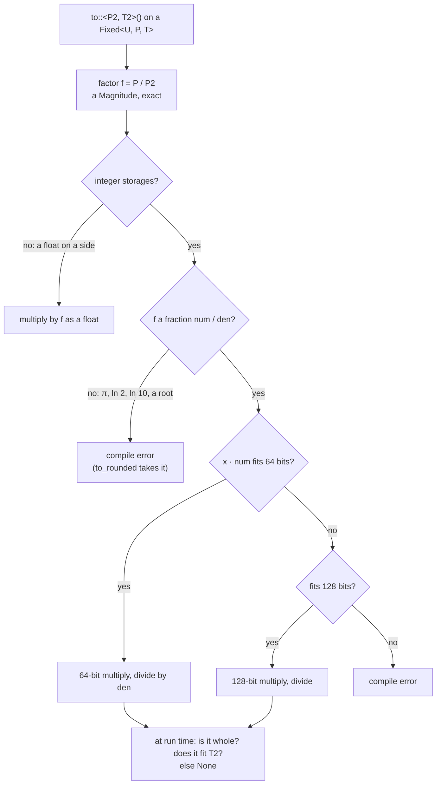

# Conversions at compile time

A conversion is decided by the compiler: which factor, whether it can be exact, which width the arithmetic needs. At run time only the arithmetic is left.

## From two scales to two constants



Each box above the last is a `const` evaluated once per pair of types. The run time keeps:

- nothing, when $f = 1$ (`Milli` to `Pow10<-3>`);
- a multiply by a constant, when $f$ is whole ([[ms]] to [[µs]]);
- a division by a constant and a remainder check, when $f = 1/n$ ([[µs]] to [[ms]]);
- a multiply, a division and a check otherwise.

A division by a constant compiles to a multiply by its inverse on most targets.

## Errors are compile errors

The decisions sit in `const { .. }` blocks inside generic functions. A panic there stops the build at the place the conversion is written, for that pair of types only:

```text
error[E0080]: evaluation panicked: an exact conversion is by a fraction of integers only: this factor has a
              power of π, ln 2 or ln 10 or a half exponent, so no value but 0 converts exactly (round with
              to_rounded or convert_rounded)
note: the above error was encountered while instantiating
      `fn Fixed::<Degree, Centi, i32>::convert::<Radian, Micro, i32>`
```

The same mechanism refuses a range that doesn't fit its storage, a product of two ranges that may overflow, a `fixed!` literal that doesn't fit and a `db!` level too close to a tie.

## Scales of products as types

Stable Rust can't compute `Pow10<{A + B}>` in a type. So the scale of a product is the marker `Product<P1, P2>`, whose `SCALE` is the exact product of the two magnitudes, worked out at compile time. Equal scales are the same scale however spelled: `Product<Milli, Milli>` to `Micro` is free.

## Literals and levels

`fixed!(0.1)` and `db!(-3)` are associated consts of a trait, `AtLiteral` and `AtLevel`, implemented for every `Fixed`. The context's type picks the impl, the const is evaluated once, and nothing of it reaches the run time.

- `fixed!` takes the exact fraction of the decimal and rounds it once.
- `db!` bounds $10^{x/20}$ in an interval of exact rationals, narrows it until one stored value is certain, and refuses a level it can't decide.

## Rounding with an irrational factor

`to_rounded` accepts $\pi$ and roots: the factor is a 64-bit fixed point $m \cdot 2^{s}$ within $2^{-64}$ of the true one, worked out at compile time from the magnitude. The run time multiplies by $m$ in 128 bits and rounds from the bits shifted out.
