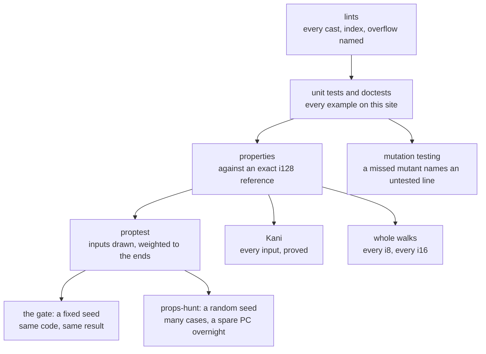

# How the crate is checked

A units crate that is wrong is worse than none: it gives false confidence. Four layers check `exact_units`.

## Lints

The crate builds under strict lints, warnings as errors in CI:

- `clippy::pedantic`, and no panics in library code (`unwrap`, `expect`, `unreachable`, `panic`).
- **Casts** (`as_conversions`, the cast lints): a cast that can lose information is `From` / `TryFrom`, or carries a reason saying why the value fits.
- **Indexing** (`indexing_slicing`): slices are read with `get` or an iterator.
- **Overflow** (`arithmetic_side_effects`): every operation that can overflow says what it means. `wrapping_*` where wrapping is the meaning, `saturating_*` for the `Saturating` bound, `checked_*` where the API returns `Option`, otherwise an `#[expect]` stating the invariant (`i16 * i16 fits in i32`).
- A suppression is `#[expect(lint, reason = "...")]` on the narrowest item. A reason that can't say why is a bug.

None of these may add work on Cortex-M where the old operation could not overflow.

## Every example runs

- Doctests: every Rust block in the API docs, the README and every page of this book (`src/book.rs` includes the pages). A block marked "doesn't compile" must fail to compile.
- The 14 examples are built in CI and print their stories.
- The plots on this site are computed by the crate when the site is built.

## Properties against a reference

`tests/props` holds properties. Each is a plain function that takes its inputs and asserts the crate agrees with an exact reference, written in `i128` without the crate's helpers:

$$
\forall x:\ \texttt{to\_rounded}(x) = \operatorname{round}_r\!\left(x \cdot \tfrac{\text{num}}{\text{den}}\right) \text{ computed in } \mathbb{Z}
$$

Each property is checked three ways from the same function:

- **proptest** draws inputs, weighted to the ends of the range, where the bugs are.
- **Kani** proves it for every input at once, by bounded model checking (`just verify`). Proofs use storages of 16 bits or less: a proof over `i16` takes seconds, over `i32` pairs ten minutes and more.
- **Whole walks**: where the space is small (every `i8`, every `i16`, every Q15 pair) a plain test tries all of it.

A fix comes with a property, or an input for one, that fails before the fix. A bug in a narrow window, like a cast that wraps at $2^{32}$, gets a strategy aimed at that window: random inputs never hit it.

`just test` runs proptest with a fixed seed: the same code gives the same result, so neither the land gate nor a mutation-testing run turns on which cases a draw happened to land on. `just props-hunt` hunts instead, with proptest's own random seed and many more cases, meant for a spare PC overnight rather than the gate. A case it finds is pinned to `tests/proptest-regressions/`, the same file the gate replays, so a found regression stays caught from then on.

## Mutation testing

A test suite can pass while checking nothing: a line nobody's test depends on can be wrong and no test notices. cargo-mutants checks for that: it changes the library one line at a time (a mutant) and runs the tests after each change (`just mutants`). A mutant the tests catch is fine. A mutant that survives (MISSED) names a line that could hide a bug.

`.cargo/mutants.toml` leaves out Debug and defmt output and the test-only customary catalogue, each with a reason: no test should pin those. It is a dev tool, not a dependency, and not in CI; a full run takes hours.

The first run (2 Nov 2026) tested 3920 mutants and missed 422. Closing the gaps it found brought several modules to zero: `fixed/rounding.rs` from 51 missed to 0, `magnitude/approx.rs` from 47 to 0, the wire's `validate` functions from 3 to 0. It also found a real bug: `Requantizer::apply` rounded a quotient wrongly for a factor whose denominator is above `i128::MAX`, now fixed with a property against the exact case.

## Coverage and targets

- Coverage is measured on every CI run (`cargo llvm-cov`, uploaded to Codecov).
- CI builds for `thumbv6m-none-eabi` (Cortex-M0) without `std`, and for `thumbv7em-none-eabihf` with `libm`.
- The instruction counts on [Cost on Cortex-M](../fixed_point/cost.md) come from comparing the ELF of plain and typed twins.

## Fuzzing

Text, wire bytes and serde input come from outside. Their properties take strings and bytes, which Kani can't reason about, so `fuzz/` runs the same property functions under cargo-fuzz, coverage-guided:

| Target | Input |
|---|---|
| `decimal` | any text into `Decimal::parse`, what `fixed!` runs |
| `decibels` | any text into `Decibels::parse` and `from_db_const`, what `db!` runs |
| `names` | any text into `Prefix::from_name` and `units::by_name` |
| `wire_bytes` | any bytes decoded as one of the wire types, a unit tree walked to its end |
| `wire_values` | values built from the fuzzer's data, encoded and decoded to themselves |
| `serde_json` | any text read with serde as `Magnitude`, `Offset`, `DimOwned` and `ProvenanceOwned` |

`just fuzz TARGET SECONDS` runs one target, from the hand-written seeds in `fuzz/seeds/TARGET` (a nightly toolchain and `cargo-fuzz`, not in CI). A crash becomes a unit test and a fix.

Two bugs it found:

- serde read a `DimOwned` with its bases out of order, so one dimension had two values that compared unequal. serde now refuses a dimension that isn't canonical, as the wire reader does.
- A unit tree could be built and written deeper than any reader follows. A typed unit of more than `MAX_UNIT_DEPTH` (32) levels is now a compile error.
