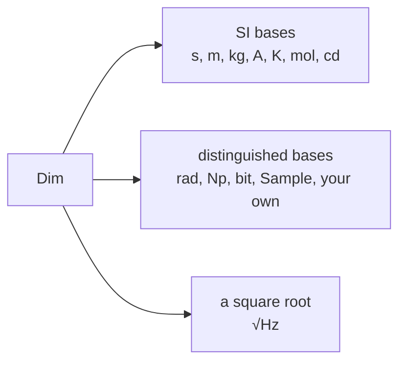

# Units and dimensions

## Unit markers

A unit is a zero-size marker type in `exact_units::units`: `Second`, `Volt`, `Byte`, `Sample`. Each knows its dimension, its symbol and its exact scale.

The markers come in groups, one cargo feature each. A firmware turns on only the groups it uses.

| Feature | Units |
|---|---|
| `time` | `Second`, `Minute`, `Hour`, `Day`, `Week`, `Hertz`, `HertzPerSecond`, `Baud` |
| `electrical` | `Ampere`, `Volt`, `Ohm`, `Farad`, `Siemens`, `Henry`, `Coulomb`, `Watt`, `VoltAmpere`, `Var`, `Weber`, `Tesla` |
| `fields` | `ElectricFieldStrength` ([[V/m]]), `MagneticFieldStrength` ([[A/m]]), `CurrentDensity` ([[A/m²]]), `ChargeDensity` ([[C/m³]]), `ElectricDisplacement` ([[C/m²]]), `Permittivity` ([[F/m]]), `Permeability` ([[H/m]]), `Resistivity` ([[Ω·m]]), `Conductivity` ([[S/m]]) |
| `mechanical` | `Meter`, `Gram`, `Newton`, `Pascal`, `Joule`, `Torque`, `Litre`, `Speed`, `Acceleration`, ...; `Area`, `Volume`, `Density`, `Momentum`, `MomentOfInertia`, `DynamicViscosity` ([[Pa·s]]), `KinematicViscosity` ([[m²/s]]), `EnergyDensity` ([[J/m³]]), ... |
| `angle` | `Radian`, `Degree`, `Turn`, `Steradian`, `AngularVelocity`, `AngularAcceleration` |
| `thermal` | `Kelvin` ([[°C]] and [[°F]] are origins of points, `origins::Celsius`), `HeatFluxDensity` ([[W/m²]]), `HeatCapacity` and `Entropy` ([[J/K]]), `SpecificHeatCapacity`, `ThermalConductivity`, `ThermalConductance` ([[W/K]]), `ThermalResistance` ([[K/W]]), `HeatTransferCoefficient` |
| `chemical` | `Mole`, `Katal`, `MolarConcentration` ([[mol/m³]]), `MolePerLitre`, `Molality`, `MolarMass`, `GramPerMole`, `MolarEnergy`, `MolarHeatCapacity` |
| `photometric` | `Candela`, `Lumen`, `Lux`, `Nit` (cd/[[m²]]), `LuminousEfficacy` ([[lm/W]]) |
| `radiometric` | `Irradiance` ([[W/m²]]), `RadiantIntensity` ([[W/sr]]), `Radiance` ([[W]]/([[m²]]·[[sr]])) |
| `radiation` | `Becquerel`, `Gray`, `Sievert`, `ElectronVolt`, `Exposure` ([[C/kg]]), `GrayPerSecond` ([[Gy/s]]), `SievertPerHour` |
| `dimensionless` | `Ratio`: duty, probability, scale |
| `information` | `Bit`, `Nibble`, `Byte`, `Halfword`, `Word`, `Doubleword`; with `time` the rates `BitPerSecond` (bit/s) and `BytePerSecond` (B/s) |
| `counting` | `Item`, `Sample`, `Frame`, `Packet`, `Line`, `Row`, `Record`, `Entry`, `Cycle`, `Block`, `Sector`, `Chunk`, `Char`, `Code`, `Event`, `Pulse`, `Tick`, `Channel`, `Pin`, `Step`, `Segment`, `Session`, `Boot`, `Operation`, `Argument`, `Filter`, `Fifo`, `Buffer`, `TimeQuantum`, `Scan` |
| `customary` | inch, pound, [[psi]], gallon and the rest: [Customary units](../customary.md) |

`quantities` turns on every group but `customary`. `std` turns on `quantities`.

The derived units are the coherent ones of the SI Brochure's tables 5 and 6, plus a few exact everyday scales (`MolePerLitre`, `GramPerCubicCentimeter`, `GramPerMole`, `SievertPerHour`). [Printing values](display.md#prefixes-on-powers) shows how a prefix is written on a unit with a power.

## Building units

Three markers build the units nobody named:

- `Per<A, B>`: a quotient, $A / B$. A voltage gain is `Per<Volt, Volt>`.
- `Times<A, B>`: a product, $A \cdot B$. An impulse is `Times<Newton, Second>`.
- `Sqrt<A>`: a root, $\sqrt{A}$. A noise density is `Per<Volt, Sqrt<Hertz>>`.

```rust
use exact_units::{Fixed, prefix::Nano, units::{Hertz, Per, Sqrt, Volt}};

let noise: Fixed<Per<Volt, Sqrt<Hertz>>, Nano, u32> = Fixed::new(12);
assert_eq!(noise.to_string(), "12 nV/√Hz");
```

## Dimensions

Every unit has a dimension: the powers of the base quantities it is made of. A volt is

$$
\unit{V} = \unit{kg} \cdot \unit{m}^{2} \cdot \unit{s}^{-3} \cdot \unit{A}^{-1}
$$

Two units convert only when their dimensions are equal. Besides the seven SI bases, `exact_units` has more:



A distinguished base is a dimension the SI counts as one ($\unit{rad} = 1$, $\mathrm{Np} = 1$), named by the crate and marker that
declare it: this crate's `Radian`, `Neper`, `NeperLoss` and `Bit`, and a crate's own count (`Sample`, a sensor's
`Pixel`). There is no limit on how many a dimension carries at once.

### Angle is a dimension

In SI an angle is a plain number. Here it is a dimension of its own, so two classic mix-ups don't compile.

A torque is [[N·m]] per radian, not an energy:

```rust,compile_fail
use exact_units::{Fixed, prefix::One, units::{Joule, Torque}};

let _ = Fixed::<Torque, One, i32>::new(5).convert::<Joule, One, i32>();
```

50 [[Hz]] is not 50 [[rad/s]]:

```rust,compile_fail
use exact_units::{Fixed, prefix::One, units::{AngularVelocity, Hertz}};

let _ = Fixed::<Hertz, One, u32>::new(50).convert::<AngularVelocity, One, u32>();
```

### Samples, bytes and other distinguished bases

Samples, packets, frames and bytes are each a distinguished base of their own, like the radian and the bit. A
buffer sized in samples is not one sized in bytes:

```rust,compile_fail
use exact_units::{Fixed, prefix::One, units::{Byte, Sample}};

let samples: Fixed<Sample, One, u32> = Fixed::new(256);
let _ = samples.convert::<Byte, One, u32>();
```

An API declares a distinguished base of its own too, with a `base` line:
[Your own units](../units/declare.md#distinguished-bases-from-other-crates).

## Quantities

A unit measures a [quantity](../maths/quantities.md), not just a dimension: a height and a width are both lengths,
but don't convert into each other; a resistance ([[Ω]]) and a transimpedance ([[V/A]]), a voltage gain ([[V/V]]) and a duty
cycle share a dimension and still mean different things, so they don't convert into each other either.
