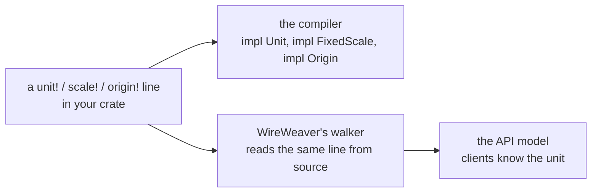

# Your own units

Three macros declare markers of your own: `unit!`, `scale!` and `origin!`. Each line is data, literal values only, for two readers:



So a tool that only has your device's API model still knows what `rpm` means. A hand-written `impl Unit` compiles, but WireWeaver refuses an API that uses it.

## `unit!`

```rust
exact_units::unit! {
    /// Revolutions per minute: 2π rad / 60 s, exactly.
    pub struct Rpm = "rpm", [rad 1, s -1], Exact(1 / 30, pi 1);
    /// A count of histogram buckets, a base of its own.
    pub struct Bucket = "bucket", counted;
}

use exact_units::{Fixed, Unit, prefix::One};

let speed = Fixed::<Rpm, One, u8>::new(60);
assert_eq!(speed.to_string(), "60 rpm");
// 60 rpm in rad/s
assert!((Rpm::EXPR.factor() * 60.0 - core::f64::consts::TAU).abs() < 1e-12);
assert_eq!(Bucket::DIM, exact_units::counted!(Bucket));
```

A line is `<attributes> <visibility> struct <Name> = "<symbol>", <dimension>[, <scale>];`:

- **Dimension**: exponents of `s`, `m`, `kg`, `a`, `k`, `mol`, `cd`, `rad`, `bit` (`[kg 1, m 2, s -3, a -1]` is a volt, `[]` a plain number), or `counted` for a base of its own, named by your crate and the marker.
- **Scale**, an exact [`Magnitude`](../nomicon/magnitude.md), one when left out: `Pow10(-3)`, or `Exact(num / den, pow10 e, pow2 e, pi e)`. A unit has no offset: a scale with a zero of its own, like °C, is an [origin](../points/points.md) of points.
- **Kind**, after the dimension: `kind "resistance"` makes a unit that doesn't convert to others of its dimension.
- **Provenance**, after the scale: `conventional("NIST SP 811", 2008)` marks a unit fixed by a measured property (inHg at 32 °F) rather than a definition.

A float factor is not a scale: an exact one is a [`Magnitude`](../nomicon/magnitude.md), and a factor known only at run time (a calibration) is a value.

## `scale!`

A step of your own: a gyro's 70 mdps per LSB, a quarter.

```rust
exact_units::scale! {
    /// One step of a gyro: 70/1000 of the unit.
    pub struct Mdps70 = "", Exact(70 / 1000);
    /// A quarter, 2⁻².
    pub struct Quarter = "", Pow2(-2);
}

use exact_units::{FixedScale, Magnitude};

assert_eq!(Mdps70::SCALE, Magnitude::ratio(7, 100));
assert_eq!(Quarter::SCALE.to_f64(), 0.25);
```

## `origin!`

An origin for [points](../points/points.md): from the unit's zero, or above another origin.

```rust
use exact_units::{Fixed, Magnitude, Offset, Point, origin, origins::Celsius, prefix::One, units::Kelvin};

origin! {
    /// Degrees Rømer: water freezes at 7.5 °Rø and boils at 60 °Rø, so a degree is 40/21 K and
    /// 0 °Rø is 273.15 − 7.5 · 40/21 = 108723/420 K.
    pub struct Romer { unit: Kelvin, symbol: "°Rø", offset: Offset::ratio(108723, 420), step: Magnitude::ratio(40, 21) }
}

type DegRo = Point<Romer, Fixed<Kelvin, exact_units::prefix::Rational<40, 21>, i16>>;
// water boils
assert_eq!(DegRo::from_raw(60).to::<Celsius, One, i16>().map(|p| p.raw()), Some(100));
```

After `offset` come, in this order and each optional: `step` (1), `reference` (the unit's zero) and `modulus` (`Linear`, or `Modulo<..>` for an angle that wraps).

## Counted bases from other crates

A counted marker's dimension is named by its crate and its name: `counted!(Bucket)` in your crate is a different base from a `Bucket` in another crate. Two APIs can't mix their buckets by accident.
