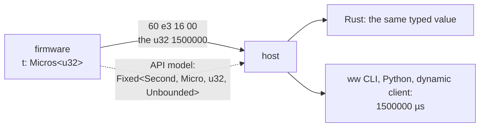

# The wire

With the `shrink_wrap` feature (opt-in, not a default) every type gets the wire format of [WireWeaver](https://github.com/vhrdtech/wire_weaver), `shrink_wrap`. The rule is simple: **a `Fixed` is its integer on the wire**. The unit, the scale and the bounds are in the API model, not in the bytes.



## Same bytes as the plain struct

```rust
use exact_units::{Fixed, Micros, prefix::Milli, units::Volt};
use shrink_wrap::prelude::*;

#[derive_shrink_wrap(borrowed, derive(Debug, PartialEq))]
struct Reading {
    t: Micros<u32>,                  // since boot
    cell: Fixed<Volt, Milli, u16>,   // the cell's voltage
}

#[derive_shrink_wrap(borrowed, derive(Debug, PartialEq))]
struct PlainReading {
    t: u32,     // µs, says the comment
    cell: u16,  // mV
}

let typed = Reading { t: Fixed::new(1_500_000), cell: Fixed::new(3710) };
let plain = PlainReading { t: 1_500_000, cell: 3710 };
let (mut a, mut b) = ([0u8; 16], [0u8; 16]);
let typed_bytes = typed.to_ww_bytes(&mut a).unwrap();
assert_eq!(typed_bytes, plain.to_ww_bytes(&mut b).unwrap());
assert_eq!(Reading::from_ww_bytes(typed_bytes).unwrap(), typed);
```

A firmware can move a field from `u32` to `Micros<u32>` without changing a byte. A later change of the scale changes the type, so it is a change the API's reviewers see, and WireWeaver's evolution checker refuses.

## Bounds are checked on read

A bounded value is checked on every read from the wire. A `set` of a property out of range is refused before the handler runs:

```rust
use exact_units::{Fixed, Range, prefix::Milli, units::Second};
use shrink_wrap::prelude::*;

type Timeout = Fixed<Second, Milli, u16, Range<1, 5000>>;

let mut buf = [0u8; 4];
let ok = Fixed::<Second, Milli, u16>::new(100).to_ww_bytes(&mut buf).unwrap().to_vec();
assert!(Timeout::from_ww_bytes(&ok).is_ok());
let zero = Fixed::<Second, Milli, u16>::new(0).to_ww_bytes(&mut buf).unwrap().to_vec();
assert!(Timeout::from_ww_bytes(&zero).is_err()); // 0 ms is out of 1..=5000
```

The same holds for `IndexFrom1` (0 is refused) and every bounded index.

## In a WireWeaver API

`Fixed` goes into properties, method arguments and `Series` like any type:

```text
#[ww_trait]
trait Device {
    property!(rw timeout: Fixed<Second, Milli, u16>);
    property!(rw window: Fixed<Second, Milli, u16, Range<1, 5000>>);
    fn ticks() -> Series<'i, Timed<Micros<u32>>>;
}
```

A client that has only the device's introspection data knows each field for what it is:

```text
├─ 5 rw property timeout: Fixed<Second, Milli, u16, Unbounded> [ms]
├─ 7 rw property window: Fixed<Second, Milli, u16, Range<1, 5000>> [ms, 1..=5000]
├─ 15 rw property uptime: Fixed<Second, Micro, u64, Unbounded> [µs]
```

`ww` prints values exactly (`1730000000000000 µs`, never through a float) and takes quantities in the unit you like, converted exactly or refused before anything is sent:

```text
1.5 ns can't be written into Fixed<Second, Micro, u64, Unbounded>: not a whole number of µs
6 s can't be written into Fixed<Second, Milli, u16, Range<1, 5000>>: 6000 is out of 1..=5000
```

Python gets a `ww.Quantity` with the value, the prefix, the storage and the bounds. A `Series` of `Fixed` values has the same columns and bytes as one of the plain numbers.

## A unit known only at run time

A configurable sensor channel has a unit chosen at run time. It travels as an `SIExpr`: the unit as a tree, with its dimension and exact scale.

```rust
use exact_units::{SIExpr, units::Volt};

let unit = SIExpr::of::<Volt>();
assert_eq!(unit.to_string(), "V");
```

A named unit in the tree is a leaf of one of two kinds:

- `Def`: the whole `UnitDef` (identity, symbol, dimension, scale). It reads alone, on any device. `SIExpr::of` gives these.
- `Ref`: the unit's identity alone, a `MarkerId { crate_name, name }`. It reads through a `UnitTable` that lists the unit: this crate's `units::TABLE`, a crate's `unit! { @table .. }` list, or the API model a client already has.

The identity is the crate and the marker's name, so two crates' `Rpm` are two units that print the same. A reference names a unit by that identity and not by its place in a table, so it means the same unit in every table that lists it.

`compact_in` turns each `Def` a table lists into a `Ref`, the short form a value sent beside its API carries; `resolve_in` turns them back. Without alloc, the nodes they rebuild go into an arena the caller gives; the owned form has `compact` and `resolve`. A `Def` whose identity the table lists with another definition is refused: two units under one name.

```rust
# #[cfg(all(feature = "time", feature = "mechanical"))] {
use exact_units::{SIExpr, units::{self, Meter, Per, Second}};

let speed = SIExpr::of::<Per<Meter, Second>>();
let mut arena = [const { None }; 2];
let short = speed.compact_in(&units::TABLE, &mut arena).unwrap();
// the same unit through the table, written the same
assert!(short.same(&speed, &units::TABLE));
assert_eq!(short.dim(&units::TABLE), speed.dim(&()));
assert_eq!(short.symbol(&units::TABLE).to_string(), "m/s");
// without a table that lists them, references have no dimension: a conversion over them refuses
assert_eq!(short.dim(&()), None);
assert_eq!(short.symbol(&()).to_string(), "Meter/Second");
# }
```

Every walk takes the table: `dim`, `factor`, `magnitude`, `symbol` and `same`. `Display` reads through `units::TABLE`, so this crate's units print by their symbols anywhere.

## Bit fields

A field stored as `U1` .. `U64` or `I2` .. `I64` takes exactly its bits. Three 5-bit readings pack into 2 bytes, not 3:

```rust
use exact_units::{Fixed, prefix::Milli, units::Volt};
use shrink_wrap::prelude::*;
use shrink_wrap::un::U5;

type Level = Fixed<Volt, Milli, U5>;
let a = Level::new(U5::new(9).unwrap());
let b = Level::new(U5::new(31).unwrap());
let c = Level::new(U5::zero());

let mut buf = [0u8; 8];
let mut wr = BufWriter::new(&mut buf);
wr.write(&a).unwrap();
wr.write(&b).unwrap();
wr.write(&c).unwrap();
assert_eq!(wr.finish().unwrap().len(), 2); // 15 bits
```

## serde: configs and other formats

The `serde` feature gives the same rule to any serde format: a value is its stored number. It is `no_std` without alloc, so postcard on a firmware works as well as JSON on a host.

- `Fixed`, `Point` and the indices: the stored number.
- `Complex`: `{ re, im }`.
- `Polar`: `{ abs, arg }`, each part as above.
- `Decibels`: the decimal as text in JSON or TOML, `"-3.01"`.

Reading checks the bounds, as construction does. A field marked `with_unit` reads and writes text with its unit, exactly into the field's scale:

```rust
use exact_units::{Fixed, Millis, Range, prefix::Milli, units::Second};

#[derive(serde::Serialize, serde::Deserialize, Debug, PartialEq)]
struct Config {
    period: Millis<u32>,
    timeout: Fixed<Second, Milli, u16, Range<1, 5000>>,
    #[serde(with = "exact_units::serde::with_unit")]
    debounce: Millis<u16>,
}

let c: Config = serde_json::from_str(r#"{ "period": 20, "timeout": 250, "debounce": "15 ms" }"#).unwrap();
assert_eq!(c.debounce.get(), 15);
assert_eq!(serde_json::to_string(&c).unwrap(), r#"{"period":20,"timeout":250,"debounce":"0.015 s"}"#);

// 6000 ms is past the timeout's bounds: refused, with the reason
let e = serde_json::from_str::<Config>(r#"{ "period": 20, "timeout": 6000, "debounce": "15 ms" }"#);
assert!(e.unwrap_err().to_string().starts_with("6000 ms is out of 1..=5000 ms"));
```

## More on WireWeaver's site

- [exact_units in an API](https://ww.vhrd.tech/std_library/exact_units/): `Fixed` against `ww_si::Quantity`, clients and Python.
- [Units in the model](https://ww.vhrd.tech/std_library/units_in_the_model/): how units show in an API model.
- [Everything Series](https://ww.vhrd.tech/articles/series/): sample streams.
